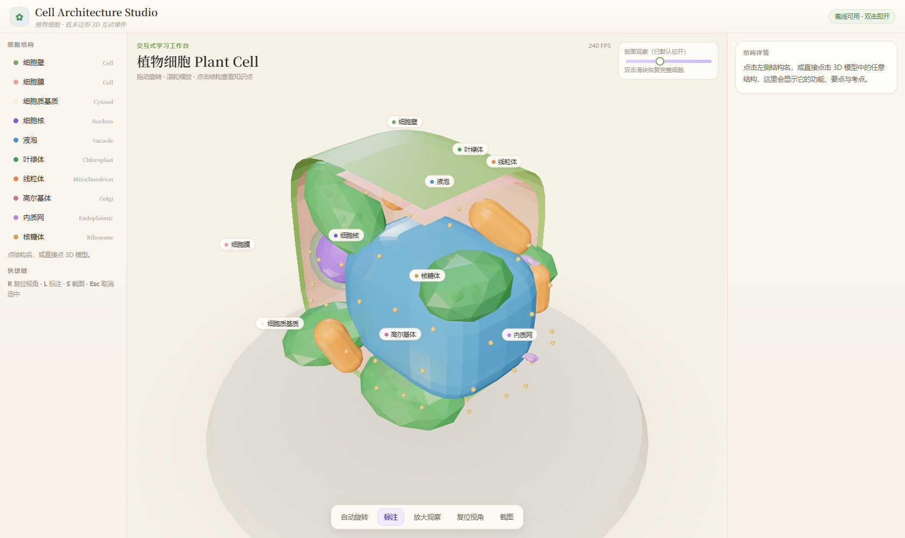

# 植物细胞 · 3D 互动课件

面向高中生物的**交互式 3D 细胞课件**：细胞壁、细胞膜、细胞核、叶绿体、线粒体、液泡、高尔基体等结构，
可用鼠标拖动旋转、滚轮缩放，点击任意结构查看名称与功能讲解。

**在线体验：** https://boy438.github.io/cell-courseware/

## 特点

- **纯静态单页**：`index.html` + 本地 Three.js，无后端、无 CDN 依赖，断网也能打开
- **低多边形（low-poly）风格**：体积小、加载快，适合课堂投影或学生手机直接打开
- **可点选高亮 + 中文讲解**：点结构出标签，配合讲解面板使用
- **可二次定制**：改 `index.html` 里的几何参数即可替换细胞器形态与配色，适合做其他章节（动物细胞、细菌、叶绿体切片等）

## 使用方式

| 场景 | 怎么做 |
|---|---|
| 在线看 | 打开上面的「在线体验」链接 |
| 本地看 | 下载仓库后双击 `index.html` |
| 课堂投屏 | 浏览器全屏（F11），学生上台自己拖动操作 |

## 技术实现

| 层 | 用到的 |
|---|---|
| 渲染 | Three.js（已本地打包在 `libs/three.min.js`） |
| 建模 | 程序化几何（球体 / 胶囊 / 环面变形组合），不依赖外部模型文件 |
| 交互 | 原生 JS 射线拾取（raycast）+ HTML 讲解面板 |
| 部署 | GitHub Pages（`main` 分支根目录） |

## 授权与致谢

- 本项目代码：MIT，可自由用于教学与二次开发
- Three.js：版权归其作者，MIT 授权
- 设计灵感来源：Dilum Sanjaya 的 *Cell Architecture Studio*；本站为独立复刻实现，未使用其素材文件

---

如果这份课件对你的课堂有用，欢迎 Star ⭐ ，也欢迎提 Issue 说想要哪个章节。
